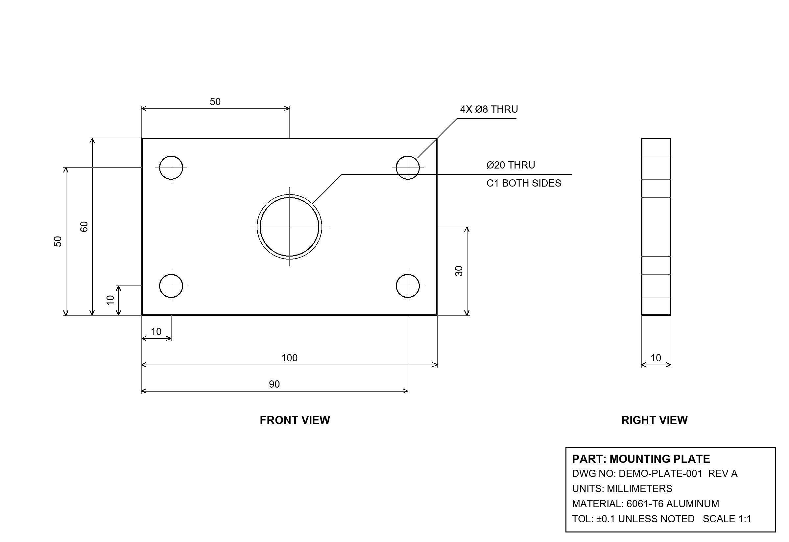
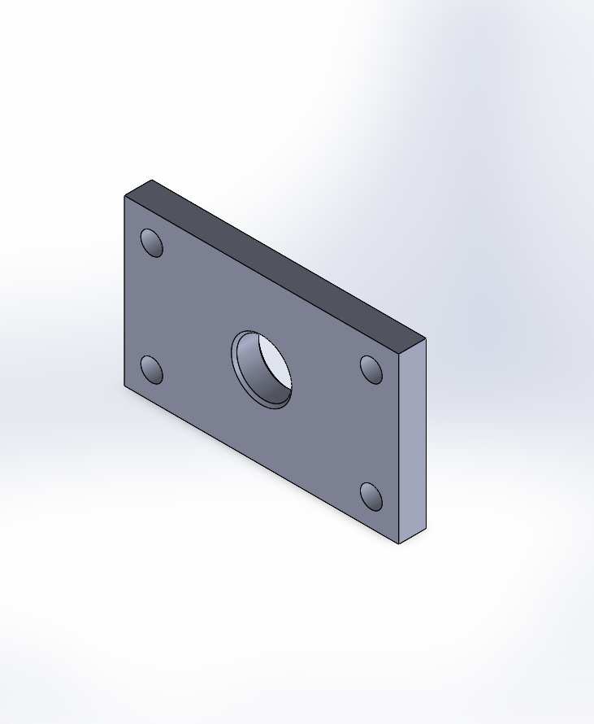

# Demo: DEMO-PLATE-001, one drawing built two ways

A simple mounting plate (100 × 60 × 10 mm, 4× Ø8 corner holes, Ø20 center bore,
C1 both sides), drawn by `make_drawing.py` from `ground_truth.json`. The drawing
is synthetic on purpose: the exact answer is known, so the built parts can be
scored geometrically instead of by eye.



## The two arms

Both arms go through the **same** pipeline: `run_models.resolve_unknowns`, then the
verification gate, the COM build (SolidWorks 2025 SP5) and the model validator. Only
the **reading** of the drawing differs.

| Arm | Who read the drawing | API cost | Extraction file |
|---|---|---|---|
| `no_api` | Claude Code, by hand in the session (written as DrawingData JSON) | **$0** API (session tokens only) | `extraction_no_api.json` |
| `astra` | GPT-6 Astra via `pipeline/extractor.py` (OpenAI Responses API) | **≤ $0.31**¹, 4,848 in / 4,486 out tokens, ~75 s | `extraction_astra.json` |

¹ The direct-OpenAI price for `gpt-6-astra` is not in `config/pricing.json` yet, so
this uses the budget guard's conservative rate (Azure Standard $10 / $50 per 1M).

## Results (`run_demo.py` → `results.json`)

Measured from the built solid: every cylindrical face's axis position and diameter,
plus the bbox and volume.

| | no_api | astra |
|---|---|---|
| Verification gate | READY | READY (after fix E014) |
| Features built | 4/4 | 4/4 |
| Holes within 0.1 mm / 0.05 mm Ø | **5/5** (0.000 mm error) | **5/5** (0.000 mm error) |
| Bounding box | 100 × 60 × 10 ✓ | 100 × 60 × 10 ✓ |
| Volume vs. truth (54,782.9 mm³, incl. chamfers) | 0.0% | 0.0% |
| Model validator | PASSED | PASSED |



Each arm's folder has the `.SLDPRT`, an isometric `.png` and a `.step`.

## What it took to get Astra's reading built

Astra read the drawing correctly on the first try: every position, diameter and the
chamfer, plus closed dimension chains. Two **pipeline** bugs stood in the way, and
both are fixed and tested (`docs/solidworks/solidworks-macro-error-log.md`):

- **E014.** The verification gate BLOCKED the 2×2 hole grid as a "240 mm row" (4 × 80
  pitch). It now checks the real extents of the explicit instance positions.
- **E015.** The resolver dropped the base plate because Astra labeled it
  `overall_width` / `overall_height`, not `length` / `width`. Both label styles now
  map to the same rectangle.

## Caveats

- One simple prismatic part. It shows the pipeline works end to end. It is **not** a
  benchmark. The MTI parts (bolt circles, stepped bores, turned shafts) are harder;
  see `STATE.md`.
- The chamfer edges are **inferred** (`EDGES INFERRED`: both mouths of the bore),
  which is right here because the drawing says "both sides".

## Re-run

```bash
python demo/simple_plate/make_drawing.py                       # drawing.png from ground_truth.json
python main.py --drawing demo/simple_plate/drawing.png --validate-only --debug   # Astra arm (API, budget-guarded)
python demo/simple_plate/run_demo.py                           # build + score both arms (Windows + SolidWorks)
```
