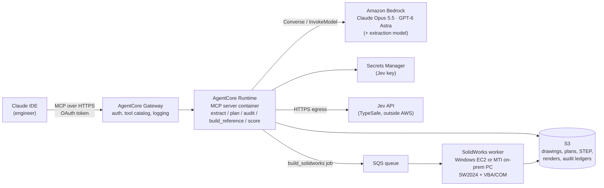

# PRD Supplement — Deployment Option 1: AWS (Amazon Bedrock + AgentCore)

**Date:** 2026-09-28 · **Author:** ggould (MalteseWarrior) · **Status:** preliminary, open for review
**Core PRD:** [PRD.md](PRD.md) · **Alternative:** [PRD-azure.md](PRD-azure.md)

> This supplement changes **only where things run**. The problem, goals,
> functional requirements (A1–D3), success metrics and milestones in the
> [core PRD](PRD.md) apply unchanged. The Azure supplement has the same sections
> in the same order, so the two can be compared line by line.

## Summary

Run the model calls on **Amazon Bedrock**, host the MCP connector on **Bedrock
AgentCore Runtime** (behind **AgentCore Gateway**), and run the SolidWorks worker on
a **Windows EC2 instance** (or MTI's own machine). Choose this option if MTI or
iNDustry Labs already standardizes on AWS, or wants IAM-governed, per-region model
access and billing through one AWS account.

Both benchmark models are on Bedrock as of September 2026: Claude Opus 5.5 (GA
Sept 22) and GPT-6 Astra (GA Sept 8). So the whole benchmark can run inside one
cloud account.

## Architecture

The SolidWorks worker **pulls** jobs from a queue instead of receiving inbound
calls. That way an on-prem MTI machine can serve as the worker without opening any
inbound firewall port.

## Service mapping

| Component (core PRD) | AWS service | Notes |
| --- | --- | --- |
| Model calls: planner, extractor, auditor reviewer | Amazon Bedrock | Opus 5.5 via the `global.` / `us.` inference profiles; GPT-6 Astra via its Bedrock model card. One IAM-scoped client per model |
| MCP connector (sub-project D) | Bedrock AgentCore Runtime | Container serving streamable-HTTP MCP at `0.0.0.0:8000/mcp`; stateless by default, stateful mode for elicitation and progress notifications |
| MCP front door | Bedrock AgentCore Gateway | Central auth, tool discovery, observability, OAuth on-behalf-of |
| Identity | Cognito, or the org IdP via OAuth / CUSTOM_JWT | Engineers sign in once; the IDE carries the bearer token |
| Artifacts (drawings, plans, STEP, renders, ledgers) | S3 | One prefix per part; ledgers stay append-only JSONL |
| Secrets (Jev key, any non-IAM keys) | AWS Secrets Manager | Bedrock itself uses IAM, so no model API keys are needed |
| SolidWorks jobs | SQS | The worker long-polls; results are written back to S3 |
| SolidWorks worker | Windows EC2 (GPU instance) or MTI on-prem PC | See [SolidWorks worker](#solidworks-worker) |
| Logs and metrics | CloudWatch | Per-attempt tokens, cost and latency, next to the ledger |

## Model access

- **Claude Opus 5.5.** Model ID `global.anthropic.claude-opus-5-5`, with US, EU, AU
  and JP geo profiles for data residency. It can be called through the Converse
  API, through InvokeModel (the native Anthropic Messages format), or through the
  `anthropic` SDK's Bedrock client.
- **GPT-6 Astra.** Generally available on Bedrock. It's called through Bedrock APIs
  with the same IAM model.
- **Extraction model.** The current pipeline defaults to `claude-sonnet-4-6`. Before
  build, confirm which Sonnet-class model the chosen Bedrock region offers, and pin
  it in config.
- **Code impact:**
  - The planner / extractor provider layer (core PRD requirement A6) gets a
    `bedrock` backend next to `anthropic` and `openai`.
  - The tool-call pattern and Pydantic repair retry stay the same. Opus 5.5
    rejects *forced* `tool_choice`, so it uses `auto` + `strict: true` (spec A).
  - Every completion is still recorded by the token tracker, with `provider`
    set to this cloud, so reports compare clouds side by side.
  - `usage_log.py` needs Bedrock prices for each pinned model.

## MCP server hosting

- **Packaging.** Package the MCP server (the same thin wrappers as in the core PRD)
  as a container, and deploy it with the AgentCore CLI.
- **Authentication.** Inbound auth is OAuth / CUSTOM_JWT (Cognito or the org IdP).
  AgentCore returns a standard 401 with protected-resource metadata, so MCP clients
  can discover the auth server.
- **Long-running calls.** `build_reference`, audits and benchmark runs can take
  minutes. Use stateful mode with progress notifications, or return a job ID and
  poll.
- **Local stdio stays available** for development. The cloud endpoint is the same
  server, deployed.

## SolidWorks worker

| Option | Pros | Cons |
| --- | --- | --- |
| **MTI on-prem PC** (recommended to start) | Uses existing licenses and a machine already validated for the macros (E001–E010); no cloud GPU cost | Availability depends on that PC; someone must keep a desktop session signed in |
| **Windows EC2 GPU instance** | Always on; scales out for the SolidWorks benchmark track | SolidWorks licensing on cloud VMs must be confirmed with MTI's reseller; GPU instance cost |

Either way, the worker runs a small agent. It long-polls SQS, runs the compiled
VBA/COM build, exports STEP, and uploads the results. SolidWorks is a desktop
application, so plan on the worker running inside an **interactive, signed-in
Windows session**, not as a background service.

## Data, residency and confidentiality

- Opus 5.5 on Bedrock supports zero data retention by default. Keep inference in
  the `us.` geo profile if MTI requires US-only processing.
- Drawings and reference STEP files live in a private S3 bucket (SSE-KMS, no public
  access). Only scores leave the bucket, and only if the confidentiality question
  in the core PRD is answered "confidential".
- **Jev is not available natively on AWS.** It's offered directly by TypeSafe and
  via Vercel and Cloudflare gateways. Jev calls carry callout text and plan fields
  out of AWS, so they need MTI's approval, or else the auditor uses its LLM
  fallback (core requirement B7) on Bedrock.

## Additional requirements (AWS)

| ID | Requirement | Priority |
| --- | --- | --- |
| AWS-1 | Model provider layer supports a `bedrock` backend for Opus 5.5 and GPT-6 Astra with IAM auth; model IDs pinned in config | P0 must |
| AWS-2 | MCP server deploys to AgentCore Runtime from the same codebase as the local stdio server | P1 should |
| AWS-3 | AgentCore Gateway fronts the runtime with the org IdP; no anonymous access | P1 should |
| AWS-4 | Artifacts and ledgers are stored in S3 with one prefix per part; the bucket is private and KMS-encrypted | P1 should |
| AWS-5 | SolidWorks worker pulls jobs from SQS and never needs an inbound port | P1 should |
| AWS-6 | Cost ledger uses Bedrock pricing for each pinned model | P1 should |
| AWS-7 | Jev egress is allow-listed (or disabled with the LLM fallback) per MTI policy | P1 should |

## Risks (AWS-specific)

| Risk | Mitigation |
| --- | --- |
| Model feature differences on Bedrock vs the direct APIs (e.g. beta features lag) | The pipeline uses only core features (vision, forced tool call). Run the benchmark's scorer self-test on Bedrock before the first real run |
| SolidWorks license terms don't allow cloud VMs | Start with the MTI on-prem worker. EC2 only after reseller confirmation |
| Worker PC offline or signed out | Queue-based design: jobs wait; the MCP tool reports "no worker online", per core requirement D2 |
| Jev egress blocked by policy | LLM fallback on Bedrock. Jev stays optional, per core requirement B7 |

## Open questions (AWS)

- [ ] Does MTI or iNDustry Labs already have an AWS account and org IdP to use?
- [ ] Which Bedrock region and geo profile: US-only, or global?
- [ ] Are SolidWorks 2024 licenses allowed on an EC2 instance, or on-prem only?
- [ ] Is outbound traffic to the Jev API allowed from the AWS account?

## Sources

- [Claude Opus 5.5 is now available on AWS](https://aws.amazon.com/blogs/machine-learning/claude-opus-5-5-is-now-available-on-aws/): model ID, geo profiles, supported APIs
- [OpenAI GPT-6 Astra is now generally available on Amazon Bedrock](https://aws.amazon.com/about-aws/whats-new/2026/09/openai-gpt-6-astra-on-amazon-bedrock/)
- [Deploy MCP servers in AgentCore Runtime](https://docs.aws.amazon.com/bedrock-agentcore/latest/devguide/runtime-mcp.html): container path, stateless/stateful modes, OAuth
- [AgentCore Runtime stateful MCP features](https://aws.amazon.com/about-aws/whats-new/2026/03/amazon-bedrock-agentcore-runtime-stateful-mcp)
- [Extending MCP support for AgentCore Gateway](https://aws.amazon.com/blogs/machine-learning/extending-mcp-support-for-amazon-bedrock-agentcore-gateway-2/)
- [Jev on Vercel AI Gateway](https://vercel.com/changelog/typesafe-ai-jev-now-available-on-ai-gateway) and [Jev on Cloudflare](https://developers.cloudflare.com/ai/models/typesafe/jev/): Jev's current distribution channels
