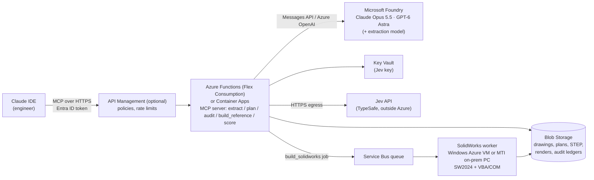

# PRD Supplement — Deployment Option 2: Azure (Microsoft Foundry + Azure Functions)

**Date:** 2026-09-28 · **Author:** ggould (MalteseWarrior) · **Status:** preliminary, open for review
**Core PRD:** [PRD.md](PRD.md) · **Alternative:** [PRD-aws.md](PRD-aws.md)

> This supplement changes **only where things run**. The problem, goals,
> functional requirements (A1–D3), success metrics and milestones in the
> [core PRD](PRD.md) apply unchanged. The AWS supplement has the same sections in
> the same order, so the two can be compared line by line.

## Summary

Run the model calls on **Microsoft Foundry**, host the MCP connector on **Azure
Functions** (or Azure Container Apps), and run the SolidWorks worker on a **Windows
Azure VM** (or MTI's own machine). Choose this option if MTI or iNDustry Labs
already runs on Microsoft 365 / Entra ID. It lets engineers sign in with their
existing Microsoft accounts and bills through an Azure subscription.

Both benchmark models are in Foundry as of September 2026: Claude Opus 5.5 (hosted
on Azure, GA) and GPT-6 Astra (GA for all customers since Sept 3). So the whole
benchmark can run inside one Azure subscription.

## Architecture

The SolidWorks worker **pulls** jobs from a queue instead of receiving inbound
calls. That way an on-prem MTI machine can serve as the worker without opening any
inbound firewall port.

## Service mapping

| Component (core PRD) | Azure service | Notes |
| --- | --- | --- |
| Model calls: planner, extractor, auditor reviewer | Microsoft Foundry | Opus 5.5 "Hosted on Azure" (Global Standard or Data Zone Standard US); GPT-6 Astra Standard (Global or US Data Zone) or Provisioned Throughput |
| MCP connector (sub-project D) | Azure Functions, Flex Consumption plan | Either the Functions MCP extension or a self-hosted MCP SDK server (preview). Container Apps with internal ingress if the endpoint must be private |
| MCP front door | API Management (optional) + API Center | Policies and rate limits; API Center gives a private catalog of the org's MCP servers |
| Identity | Microsoft Entra ID | Built-in MCP authentication on Functions implements the MCP OAuth flow; the Function app uses a managed identity for Azure resources |
| Artifacts (drawings, plans, STEP, renders, ledgers) | Blob Storage | One container prefix per part; ledgers stay append-only JSONL |
| Secrets (Jev key, any non-Entra keys) | Key Vault | Read via managed identity, never app settings in plain text |
| SolidWorks jobs | Service Bus queue | The worker receives messages; results are written back to Blob Storage |
| SolidWorks worker | Windows Azure VM (GPU) or MTI on-prem PC | See [SolidWorks worker](#solidworks-worker) |
| Logs and metrics | Application Insights | Per-attempt tokens, cost and latency, next to the ledger |

## Model access

- **Claude Opus 5.5.**
  - Deployed in Foundry through an **Azure Marketplace subscription** and billed in
    Claude Consumption Units (CCU).
  - Called with the `anthropic` SDK against
    `https://<resource>.services.ai.azure.com/anthropic/v1/messages`. The request
    shape is the same Messages API the pipeline already uses.
  - Azure-hosted deployments take images as base64 or URL. The pipeline already
    sends base64.
- **GPT-6 Astra.** A Foundry model sold directly by Azure: Standard pay-as-you-go
  or Provisioned Throughput, in Global and US Data Zone.
- **Extraction model.**
  - The current default, `claude-sonnet-4-6`, is offered in Foundry only as
    *hosted on Anthropic infrastructure* (outside Azure).
  - If processing must stay on Azure, move extraction to `claude-sonnet-5` (or
    5.5), which is hosted on Azure. Re-run the golden and extraction tests after
    the switch.
- **Content filtering.** Foundry adds no built-in content filtering for Claude
  models at deployment time. That's fine for this workload, but note it in the
  security review.
- **Code impact:**
  - The planner / extractor provider layer (core PRD requirement A6) gets a
    `foundry` backend: the `anthropic` SDK with the Foundry base URL for Claude,
    and the Azure OpenAI client for Astra.
  - The tool-call pattern and Pydantic repair retry stay the same. Opus 5.5
    rejects *forced* `tool_choice`, so it uses `auto` + `strict: true` (spec A).
  - Every completion is still recorded by the token tracker, with `provider`
    set to this cloud, so reports compare clouds side by side.
  - `usage_log.py` needs CCU and Azure prices for each pinned model.

## MCP server hosting

- **Packaging.** Deploy the same thin MCP wrappers as a Python Function app on the
  Flex Consumption plan. Either use the MCP extension (endpoint
  `/runtime/webhooks/mcp`) or host the existing MCP SDK server directly (endpoint
  `/mcp`; preview).
- **Authentication.** Use built-in MCP authentication with Entra ID, not function
  access keys. Turning it on disables key-based access.
- **Long-running calls.** `build_reference`, audits and benchmark runs can take
  minutes. Return a job ID and poll, or host on Container Apps if a single call
  must run long.
- **Local stdio stays available** for development. The cloud endpoint is the same
  server, deployed. Foundry agents can also use the server as a tool, which is
  optional.

## SolidWorks worker

| Option | Pros | Cons |
| --- | --- | --- |
| **MTI on-prem PC** (recommended to start) | Uses existing licenses and a machine already validated for the macros (E001–E010); no cloud GPU cost | Availability depends on that PC; someone must keep a desktop session signed in |
| **Windows Azure GPU VM** | Always on; can join the same Entra tenant; scales out for the SolidWorks benchmark track | SolidWorks licensing on cloud VMs must be confirmed with MTI's reseller; GPU VM cost |

Either way, the worker runs a small agent. It receives Service Bus messages, runs
the compiled VBA/COM build, exports STEP, and uploads the results. SolidWorks is a
desktop application, so plan on the worker running inside an **interactive,
signed-in Windows session**, not as a background service.

## Data, residency and confidentiality

- For US-only processing, use the **Data Zone Standard (US)** deployment for Opus
  5.5 and the **US Data Zone** for Astra.
- Microsoft documents Claude's data handling for Foundry separately. Review it with
  MTI before sending drawings.
- Drawings and reference STEP files live in a private storage account (no public
  blob access, Entra RBAC). Only scores leave it, and only if the confidentiality
  question in the core PRD is answered "confidential".
- **Jev is not available natively on Azure.** It's offered directly by TypeSafe and
  via Vercel and Cloudflare gateways. Jev calls carry callout text and plan fields
  out of Azure, so they need MTI's approval, or else the auditor uses its LLM
  fallback (core requirement B7) on Foundry.

## Additional requirements (Azure)

| ID | Requirement | Priority |
| --- | --- | --- |
| AZ-1 | Model provider layer supports a `foundry` backend for Opus 5.5 (Anthropic SDK, Foundry endpoint) and GPT-6 Astra (Azure OpenAI); model IDs pinned in config | P0 must |
| AZ-2 | MCP server deploys to Azure Functions (or Container Apps) from the same codebase as the local stdio server | P1 should |
| AZ-3 | Built-in MCP authentication with Entra ID; function access keys disabled | P1 should |
| AZ-4 | Artifacts and ledgers are stored in Blob Storage with one prefix per part; the account is private | P1 should |
| AZ-5 | SolidWorks worker receives jobs from Service Bus and never needs an inbound port | P1 should |
| AZ-6 | Cost ledger uses CCU / Azure pricing for each pinned model | P1 should |
| AZ-7 | Extraction runs on an Azure-hosted Claude model if data must stay on Azure (Sonnet 5 / 5.5 instead of Sonnet 4.6) | P1 should |
| AZ-8 | Jev egress is allow-listed (or disabled with the LLM fallback) per MTI policy | P1 should |

## Risks (Azure-specific)

| Risk | Mitigation |
| --- | --- |
| Moving the extractor off `claude-sonnet-4-6` changes extraction quality | Re-run golden tests and the dev split before switching. Record the model in every run manifest |
| Self-hosted MCP on Functions is in preview | Use the MCP extension or Container Apps for production. Keep the server SDK-standard so it can move |
| SolidWorks license terms don't allow cloud VMs | Start with the MTI on-prem worker. Azure VM only after reseller confirmation |
| Worker PC offline or signed out | Queue-based design: jobs wait; the MCP tool reports "no worker online", per core requirement D2 |
| Jev egress blocked by policy | LLM fallback on Foundry. Jev stays optional, per core requirement B7 |

## Open questions (Azure)

- [ ] Does MTI or iNDustry Labs already have an Azure subscription and Entra tenant to use?
- [ ] Global or US Data Zone deployments?
- [ ] Is an Azure Marketplace subscription for Claude (CCU billing) allowed under the org's procurement rules?
- [ ] Are SolidWorks 2024 licenses allowed on an Azure VM, or on-prem only?
- [ ] Is outbound traffic to the Jev API allowed from the Azure subscription?

## Sources

- [Claude models in Microsoft Foundry](https://learn.microsoft.com/en-us/azure/foundry/foundry-models/concepts/claude-models): hosting versions, Opus 5.5 availability, deployment types, endpoint, billing
- [GPT-6 Astra generally available in Microsoft Foundry](https://azure.microsoft.com/en-us/blog/gpt-6-astra-frontier-intelligence-for-work-now-generally-available-in-microsoft-foundry/): GA, Standard and Provisioned deployments
- [Tutorial: Host an MCP server on Azure Functions](https://learn.microsoft.com/en-us/azure/azure-functions/functions-mcp-tutorial): MCP extension vs self-hosted, endpoints, built-in Entra auth, Flex Consumption
- [Build and register an MCP server for Foundry](https://learn.microsoft.com/en-us/azure/foundry/mcp/build-your-own-mcp-server)
- [Jev on Vercel AI Gateway](https://vercel.com/changelog/typesafe-ai-jev-now-available-on-ai-gateway) and [Jev on Cloudflare](https://developers.cloudflare.com/ai/models/typesafe/jev/): Jev's current distribution channels
