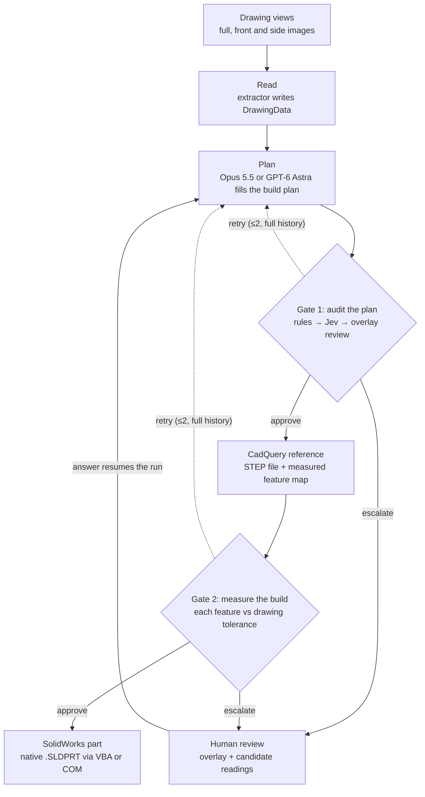
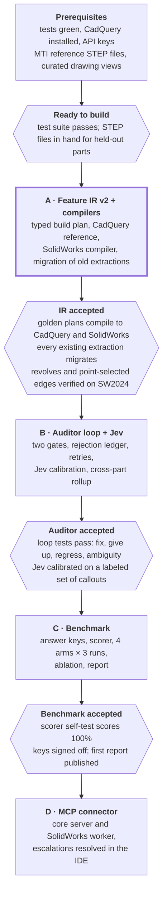

# MTI 2D→3D AI CAD — Product Requirements Document

**Date:** 2026-09-28 · **Author:** ggould (MalteseWarrior) · **Status:** preliminary, open for collaborator review

> Review through a PR. Comment on lines, propose priority or target changes, and
> tick open questions as they're answered. Related: [STATE.md](../STATE.md),
> [roadmap spec](superpowers/specs/2026-09-28-ai-cad-roadmap-design.md).

## Problem statement

MTI needs an AI system that turns a 2D engineering drawing into a SolidWorks part
with **every feature in the right place and at the right size**. Today's pipeline
reads dimensions well but builds only 10 of 26 features on its five finished
parts, and its validator still reports PASSED.

We will fix this in three moves:

- **Make placement explicit.** The model writes a typed build plan in which every
  coordinate is traced back to a drawing dimension.
- **Audit before and after building.** An agentic auditor can reject a design,
  explain why, and give the model up to two retries.
- **Measure which model is best.** Claude Opus 5.5 and OpenAI GPT-6 Astra are
  compared against MTI's own reference models, scored on relative placement
  rather than overall shape.

The result reaches engineers through an MCP connector inside their Claude IDE.

**What we're asking reviewers:** confirm the goals, the requirements and the
success targets below, and answer the [open questions](#open-questions-for-reviewers).

## Background and current state

The existing pipeline (first built June 2026) runs in five steps:

1. Claude vision reads the drawing into a structured schema.
2. An arithmetic check marks the part READY or BLOCKED.
3. The pipeline generates numbered SolidWorks VBA macros, or drives SolidWorks
   directly over COM.
4. A static audit bans SolidWorks API calls that don't exist.
5. Ten runtime failures on real machines ([error log](solidworks-macro-error-log.md)
   E001–E010) have hardened the generator.

Measured results on the five parts built to `.SLDPRT` (June 18, 2026):

| Part | What it is | Features built | Validator |
| --- | --- | --- | --- |
| A040911E | Bronze flanged bearing | 2 of 5 | PASSED |
| A040921E | Steel spacer sleeve | 2 of 4 | PASSED |
| SB11033 | Work backup, flange + bolt circle | 3 of 7 | PASSED |
| SB11780 | 76.88 in tie rod, turned shoulders | 1 of 5 | PASSED |
| SB11842 | Spindle back-up flange | 2 of 5 | PASSED |

Where it breaks:

- **Placement.** Bolt-circle and patterned holes are never placed automatically.
  Offset bosses are built with no offset. Turned parts collapse to a single cylinder.
- **Edge features.** Every fillet and chamfer failed in the COM path.
- **Verification.** The validator checks only the envelope and volume, so it passes
  incomplete parts. The batch driver silently accepts best-guess values for
  ambiguous dimensions.
- **Schema.** Hole positions mix two coordinate frames, part center and lower-left
  corner.
- **Data quality.** In `NewVerifiedDrawings/`, many images named as front or side
  views show unrelated components. That set must be labeled by hand before use.

## Goals and non-goals

**Goals**

1. Build every feature a drawing specifies, placed and sized within the drawing's
   tolerance.
2. Never report a part as good when features are missing or misplaced.
3. Make each placement decision traceable to the drawing dimension it came from.
4. Give the model a structured rejection history and up to two retries per gate
   before a human is pulled in.
5. Find out, with our own parts and our own metric, whether Opus 5.5 or GPT-6 Astra
   is better at placement.
6. Deliver a native, editable SolidWorks part, with a CadQuery/STEP reference solid
   as the measured check.
7. Make the workflow usable from the team's Claude IDE through an MCP connector.

**Non-goals (this phase)**

- Assemblies, and sheet-metal bends or flat patterns (the 12 GA parts are modeled
  as plain plates).
- Modeled thread geometry (threads stay cosmetic).
- Lofts, sweeps, shells, drafts and surfacing.
- Full GD&T interpretation (datums and tolerances are carried through, not verified).
- Replacing engineer sign-off. Escalated parts go to a person by design.

## Users and use cases

| User | Needs to | Today |
| --- | --- | --- |
| MTI design engineer | Turn a legacy drawing into an editable SolidWorks part, and review only what the system couldn't settle | Copies macros to a SolidWorks machine, runs them in order, then adds holes, fillets and chamfers by hand |
| AILOT development team | Change prompts, the plan format or the compilers, and see immediately whether placement got better or worse | Eyeballs built models and reads design-decision text files |
| Project lead / reviewer | Decide which model and approach to invest in, based on evidence | Vendor benchmark numbers that don't measure placement |
| IDE user (connector) | Drop in a drawing, watch it plan, audit and build, and answer escalations in place | Not available |

**Core use cases**

1. **Convert a drawing.** Upload views. Receive an approved plan, a STEP reference
   and a SolidWorks part, or an escalation listing exactly what is unclear.
2. **Resolve an escalation.** See the drawing with the plan drawn over it, choose
   between candidate readings, and resume the run.
3. **Run the benchmark.** Choose parts and arms, and get a report of placement,
   dimensional and completeness scores per model.
4. **Review rejection trends.** See which kinds of mistakes each model makes most,
   across all parts.

## Functional requirements

P0 items are needed for the first benchmark run. Propose priority changes in the PR.

| ID | Requirement | Priority |
| --- | --- | --- |
| A1 | Every number in the build plan is an expression over drawing dimension IDs (e.g. `D003 / 2`). Any literal other than 0, 1 or 2 needs a written justification | P0 must |
| A2 | One coordinate frame per part; positions are global coordinates; each feature states its start face and which way is into the material | P0 must |
| A3 | The plan supports prisms (rectangle, circle, slot, polygon), revolves, holes (thru, blind, counterbore, countersink, cosmetic tapped), linear, grid and circular patterns, and fillets/chamfers chosen by edge query | P0 must |
| A4 | A deterministic CadQuery compiler produces a STEP reference, a measured map of every feature, and orthographic renders | P0 must |
| A5 | The SolidWorks compiler reuses the hardened macro emitters and applies fillets/chamfers by selecting edges at computed points, with no manual picking | P0 must |
| A6 | The same plan schema works with Anthropic and OpenAI models; model IDs are pinned in config | P1 should |
| A7 | Existing extraction files convert to the new plan, with unknown positions marked unresolved instead of centered | P1 should |
| B1 | Gate 1 audits the plan before building: every non-reference dimension used, no unresolved positions, features inside the envelope, dimension chains close, patterns fit | P0 must |
| B2 | Gate 2 audits the built reference: every planned feature exists, and each hole's center, diameter and depth are within drawing tolerance | P0 must |
| B3 | A deterministic failure can never be overruled by Jev or the LLM reviewer | P0 must |
| B4 | Up to 2 retries per gate; the model gets the full rejection history; an already-fixed issue that reappears escalates early | P0 must |
| B5 | An append-only ledger per part records every attempt, finding and verdict | P0 must |
| B6 | Visual review with the plan drawn over each drawing view at scale | P1 should |
| B7 | Jev answers bounded checks (hole type, pattern type, reference dimension, chain symmetry) and the retry-or-escalate call. It is calibrated before it is trusted, with an LLM fallback | P1 should |
| B8 | A cross-part rollup of the most common rejection reasons, by model and by part family | P1 should |
| C1 | Answer keys are generated from MTI reference STEP files, each signed off by a person | P0 must |
| C2 | Scores: placement pass rate, relative placement, dimensional pass rate, completeness, exact-part rate. IoU is reported only for comparison with public benchmarks | P0 must |
| C3 | Arms: Opus 5.5 and GPT-6 Astra, each raw and audited, sharing one fixed auditor; 3 runs per part per arm | P0 must |
| C4 | Dev and held-out parts are fixed before any tuning | P0 must |
| C5 | A fixed-read ablation (both models plan from the same extraction) and a reviewer-swap sensitivity check | P1 should |
| C6 | SolidWorks track: native builds scored against the same keys | P2 later |
| D1 | An MCP server with tools to extract, plan, audit, build, compare, read the ledger, run the benchmark and resolve escalations | P1 should |
| D2 | A SolidWorks worker on a Windows host registers with the core server; SolidWorks builds are offered only while it is online | P1 should |
| D3 | Escalations resolved from the IDE are recorded as human decisions, and the run resumes | P2 later |

## Non-functional requirements

- **Determinism.** The same plan always compiles to byte-identical CadQuery and
  SolidWorks output, so golden tests can catch drift. Only the LLM steps vary
  between runs.
- **Traceability.** Every built coordinate traces back to drawing dimension IDs.
  Every rejection, retry and human decision is kept in the ledger and can be replayed.
- **No invented SolidWorks API.** Each new SolidWorks call is confirmed against a
  recorded macro on SolidWorks 2024 before it ships (an existing hard rule).
- **Platform.** Extraction, planning, auditing, CadQuery and scoring run on any OS.
  Only SolidWorks builds need the Windows + SolidWorks 2024 host.
- **Cost visibility.** Tokens, dollars and wall time are logged per attempt. No paid
  extraction is ever lost; it is saved even when BLOCKED.
- **Reproducibility.** Every benchmark run pins model IDs, prompt hashes, schema and
  auditor versions, the Jev calibration and the git commit.
- **Confidentiality.** MTI drawings and reference models stay out of public places.
  If they're confidential, reference files and keys live outside git and only
  scores are committed.
- **Secrets.** API keys are kept only in `.env` or the server environment, never in
  git or tool payloads. Every `.env` variant is gitignored.

## Success metrics and acceptance criteria

The headline is **exact-part rate on held-out parts**: every feature present, placed
and sized within tolerance. The targets below are proposals for reviewers to confirm
or change. They apply to the best audited arm, measured against MTI reference models.

| Metric | Baseline today | Proposed target |
| --- | --- | --- |
| Feature completeness (recall) | 38% (10 of 26, five COM parts) | 95% or more |
| Placement pass rate (center within tolerance) | Not measured | 90% or more |
| Relative placement (pairs within tolerance) | Not measured | 90% or more |
| Dimensional pass rate (diameter, depth) | Not measured | 95% or more |
| Exact-part rate | 0 of 5 | 60% or more of held-out parts |
| False approvals (auditor approves, reference check fails) | 5 of 5 (validator PASSED on all) | 0 |
| Escalation rate | Not tracked | 30% or less, each with a specific finding |
| Fillets/chamfers applied without manual picking | 0% | 90% or more |

> Open for review: is 60% exact-part rate the right bar for this phase, or should
> this phase target feature completeness first and leave exact parts for later?

**Acceptance for this phase:**

1. Both models have been run through all four main arms on every signed-off
   held-out part.
2. The report states which model leads on exact-part rate and relative placement,
   with the spread across 3 runs.
3. The report states how much the auditor loop improves each model.

## Solution overview

The model plans and deterministic code builds. Two audit gates stand between a plan
and a delivered part.

Either gate can send the plan back with the full rejection history (up to twice per
gate) or escalate it to a person. Every attempt is written to the part's audit ledger.

- **Feature IR v2 (sub-project A).** A typed build plan with one part frame and named
  datums. Every coordinate is written as an expression over drawing dimensions. It
  compiles to CadQuery for the reference and to SolidWorks for delivery.
  [Spec](superpowers/specs/2026-09-28-feature-ir-v2-design.md)
- **Auditor loop (B).** Deterministic checks come first and can't be overruled. Jev
  answers bounded yes/no and choice questions over callout text. A pinned vision
  model reviews the plan drawn over each drawing view.
  [Spec](superpowers/specs/2026-09-28-auditor-loop-design.md)
- **Jev's role.** Jev takes text and returns typed probabilities. It is documented as
  weak with numbers, so it never judges a dimension, and every tolerance check stays
  in code.
- **Benchmark (C).** Scores the CadQuery reference against MTI's own model on
  placement, relative placement, dimensions and completeness. Opus 5.5 and GPT-6
  Astra are each run raw and audited.
  [Spec](superpowers/specs/2026-09-28-placement-benchmark-design.md)
- **MCP connector (D).** Thin tools over the same functions. A core server runs on any
  OS, and a SolidWorks worker runs on the Windows host.
  [Roadmap §D](superpowers/specs/2026-09-28-ai-cad-roadmap-design.md)

## Deployment options

This PRD is cloud-neutral: every requirement above holds wherever it runs.
Development uses the direct Anthropic and OpenAI APIs with a local stdio MCP
server. For shared use, two hosting options are specified as supplements with
identical sections:

| | [Option 1: AWS](PRD-aws.md) | [Option 2: Azure](PRD-azure.md) |
| --- | --- | --- |
| Model access | Amazon Bedrock (Opus 5.5 and GPT-6 Astra both GA) | Microsoft Foundry (Opus 5.5 hosted on Azure and GPT-6 Astra both GA) |
| MCP server | Bedrock AgentCore Runtime + Gateway | Azure Functions (or Container Apps) + optional API Management |
| Sign-in | Cognito or the org IdP (OAuth) | Microsoft Entra ID (built-in MCP auth) |
| Artifacts and ledgers | S3 | Blob Storage |
| Secrets | Secrets Manager (models use IAM) | Key Vault (managed identity) |
| SolidWorks job queue | SQS | Service Bus |
| SolidWorks worker | MTI on-prem PC, or Windows EC2 | MTI on-prem PC, or Windows Azure VM |
| Extraction model caveat | Confirm the Sonnet-class model in the chosen region | Sonnet 4.6 is Anthropic-hosted only; use Sonnet 5 / 5.5 to stay on Azure |
| Jev | External API (not on AWS) | External API (not on Azure) |

Both options keep the same code. Only the model-provider backend (requirement A6)
and the deployment wrapper for the MCP server (D1) differ.

## Milestones and sequencing

The work runs A → B → C → D. Each phase starts only when the gate before it is met,
and A is next.

No dates are set yet. Reviewers should propose a target date for each gate once MTI
confirms when the reference STEP files will be ready.

## Dependencies and prerequisites

The first two rows block sub-project A. The rest block the benchmark or the
SolidWorks track.

| Dependency | From | Needed for | Status |
| --- | --- | --- | --- |
| Existing test suite passing on dev machines (pytest is not installed on the current machine) | AILOT team | A | Not started |
| CadQuery (with OCP) installed alongside the current requirements | AILOT team | A | Not started |
| Reference models exported to STEP for the 9 benchmark parts | MTI | C | Not started |
| Decision on whether the drawings and reference models are confidential | MTI | C | Not started |
| Hand labeling of `NewVerifiedDrawings/` views (which part, which view, or separate detail) | AILOT team, MTI | C (later parts) | Not started |
| API access: Anthropic (Opus 5.5), OpenAI (`gpt-6-astra`), TypeSafe (Jev) | AILOT team | B, C | Not started |
| Windows + SolidWorks 2024 host for recorded-macro checks and the SolidWorks track | MTI or AILOT team | A (verification), C | Not started |

## Risks and mitigations

| Risk | Impact | Mitigation |
| --- | --- | --- |
| The plan format can't express some real MTI geometry | Parts escalate instead of building | Unsupported features are reported as findings. The format grows from how often each gap shows up in the rejection rollup. |
| CadQuery and SolidWorks outputs drift apart | The SolidWorks part differs from the audited reference | The SolidWorks track scores exported SolidWorks STEP against the same keys, and shared golden plans run through both compilers. |
| Constraining models to our plan format handicaps Astra, which is strongest at free-form CadQuery | Unfair comparison | A free-form CadQuery arm can be added as an ablation if results suggest this. |
| Jev is unavailable or poorly calibrated | Wrong discrete calls | Jev sits behind an interface with an LLM fallback, and is used only where its calibration beats the fallback. |
| The auditor's reviewer model favors plans from its own vendor | Biased benchmark | Deterministic checks dominate the verdict, and a reviewer-swap run is reported. |
| Tuning on the same parts we score | Inflated results | The held-out split is fixed before tuning, and changing it requires a reviewed PR. |
| New SolidWorks API calls (revolve, select by point) fail on real machines | SolidWorks builds break | Each call is confirmed with a recorded macro on SolidWorks 2024 first. Failures go into the error log, with a regression test. |
| Mislabeled drawing views feed unrelated components into one part | Impossible parts, bad benchmark data | Only human-labeled folders are used, and `NewVerifiedDrawings/` is excluded until it is curated. |

## Open questions for reviewers

Tick each one once it has an answer, and write the answer beside it in the PR.

- [ ] Are the success targets right? In particular: 60% exact-part rate, 90% placement and zero false approvals.
- [ ] Are MTI's drawings and reference models confidential? This decides whether reference files and keys can live in git.
- [ ] Which 9 reference models can MTI export to STEP first, and by when?
- [ ] Is the dev / held-out split right? Dev: 115-C, 116-C, 117-C, 135-A. Held-out: A040911E, A040921E, SB11033, SB11780, SB11842.
- [ ] What position tolerance applies when the drawing gives none? Proposal: the title-block general tolerance, otherwise ±0.005 in / ±0.1 mm.
- [ ] Should the retry budget also have a total cap per part (for example 4 planner calls) to bound cost? Decide once the first cost data is in.
- [ ] Which pinned model is the auditor's reviewer? An Opus 5.5 reviewer risks favoring Opus plans; the reviewer-swap run measures this.
- [ ] Should a free-form CadQuery arm be added to the benchmark now, or only if the IR looks like a handicap?
- [ ] Which hosting option: [AWS](PRD-aws.md) or [Azure](PRD-azure.md)? The deciding factor is likely which cloud and identity provider MTI and iNDustry Labs already use.
- [ ] Who owns the Windows + SolidWorks 2024 host, and can it run a persistent worker for the MCP connector?
- [ ] What target date should each gate have?

## References

**In this repository**

- [README.md](../README.md): project overview and quick start
- [STATE.md](../STATE.md): current status, per-part results, data-quality warning
- [CLAUDE.md](../CLAUDE.md): how to run the pipeline, hard rules, conventions
- [solidworks-macro-error-log.md](solidworks-macro-error-log.md): runtime failures E001–E010 and the rules they produced
- [Roadmap](superpowers/specs/2026-09-28-ai-cad-roadmap-design.md): decisions and architecture
- [Feature IR v2](superpowers/specs/2026-09-28-feature-ir-v2-design.md): sub-project A
- [Auditor loop](superpowers/specs/2026-09-28-auditor-loop-design.md): sub-project B
- [Placement benchmark](superpowers/specs/2026-09-28-placement-benchmark-design.md): sub-project C
- [GRAPH_REPORT.md](../graphify-out/GRAPH_REPORT.md): knowledge graph of code, docs and drawings

**External sources**

- [GPT-6 Astra announcement](https://openai.com/index/gpt-6-astra/): OpenAI
- [GPT-6 Astra's impact on CAD](https://zerowithdot.com/blog/gpt-6-astra-impact-on-cad/): BenchCAD metrics (voxel IoU, Chamfer, Hausdorff, Feature-F1) and documented placement failures
- [GPT-6 Astra BenchCAD results](https://3druck.com/en/programs/gpt-6-astra-for-3d-printing-openai-reports-top-results-in-ai-cad-generation-39162592/): 95.9% vs. Fable 5.1 84.3%, GPT-5.6 Sol 83.3%, Opus 5 82.1%
- [GPT-6 Astra for CAD](https://adam.new/gpt-6-astra-cad): Adam's SolidWorks / Onshape / Fusion integration and MCP server
- [Jev introduces decision models](https://simonwillison.net/2026/Sep/21/jev/): typed probabilistic outputs, weakness with numbers
- [Jev decision model](https://www.techtarget.com/it-infrastructure/news/366650696/Jev-decision-model-touted-as-quicker-cheaper-LLM-alternative): TechTarget coverage
